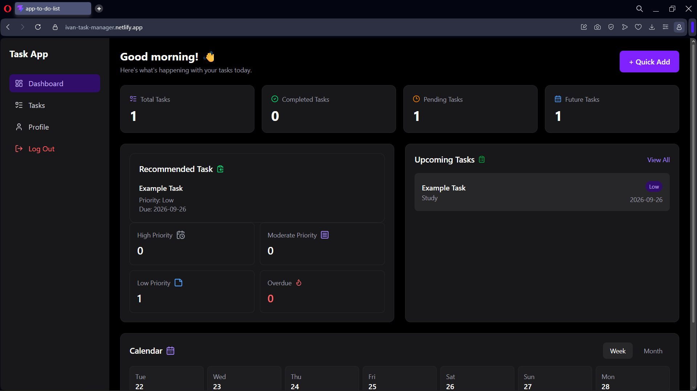
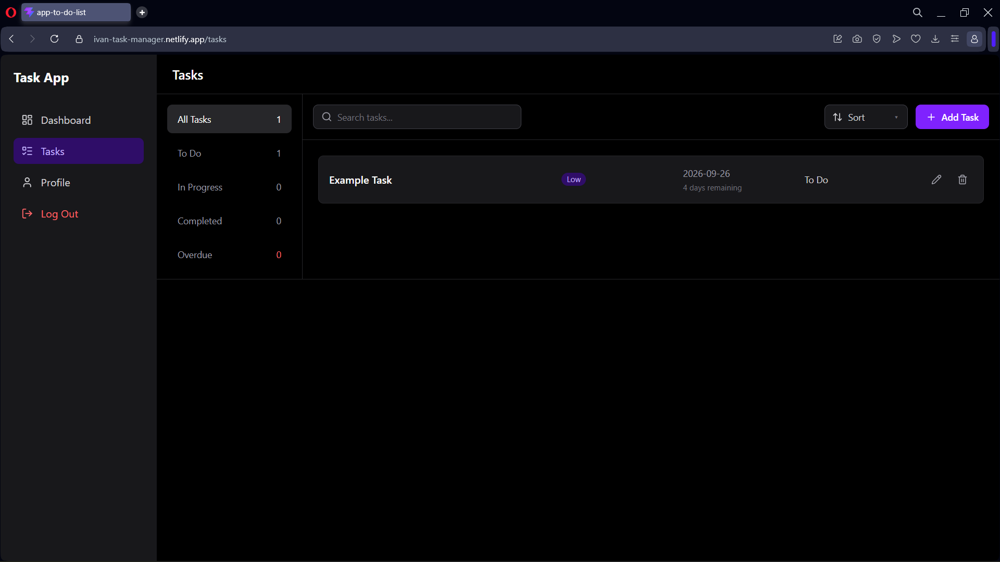
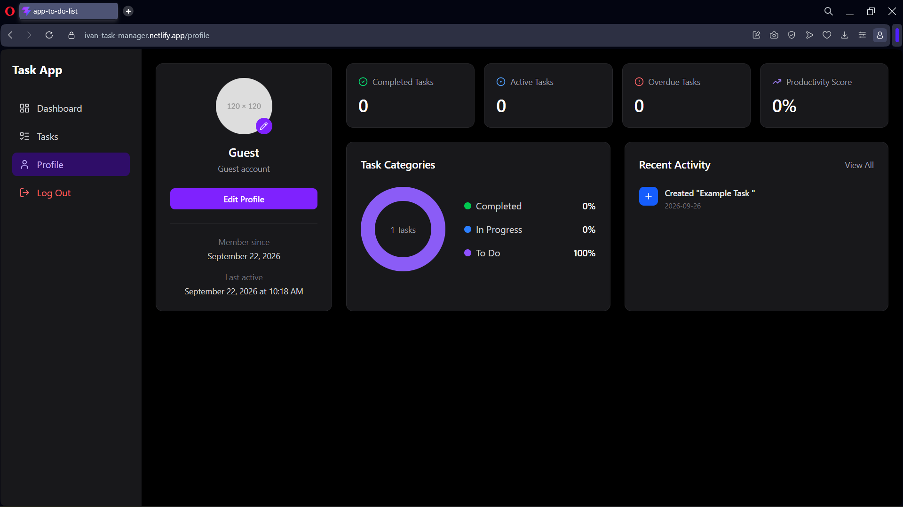
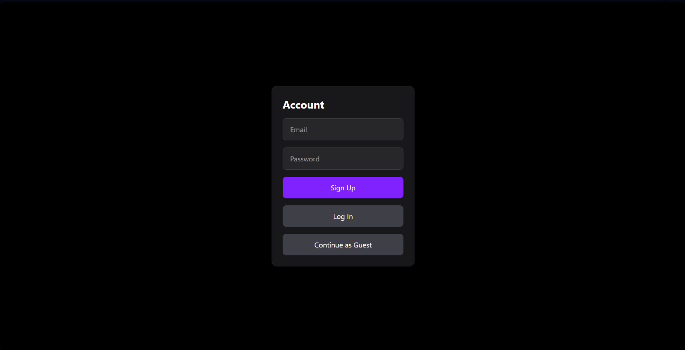

# Task Manager

A responsive task-management web application built with React and Supabase.

The application allows users to create and manage tasks, track deadlines and statistics, receive priority-based task recommendations, maintain a profile, and securely access their own data across sessions.

## Screenshots

### Dashboard


### Tasks


### Profile


### Login


## Live Demo

https://ivan-task-manager.netlify.app

## Features

- Create, edit, complete, and delete tasks.
- Search tasks by title.
- Filter tasks by status.
- Sort tasks by date and priority.
- Track task due dates and overdue tasks.
- View upcoming tasks in a calendar.
- View task statistics on the dashboard.
- Receive a recommended task based on priority and due-date urgency.
- Create and update a user profile.
- Register and log in with a user account.
- Continue using the application through anonymous guest authentication.
- Store task and profile data persistently with Supabase.
- Protect user-specific data using Supabase Row Level Security.

## How It Works

The application uses React for the user interface and application state, while Supabase provides authentication and persistent database storage.

The general data flow is:

```text
User
  ↓
React UI
  ↓
App.jsx
  ↓
Pages and components
  ↓
React state
  ↕
Supabase
  ├── Authentication
  └── Database
```

When a user authenticates, Supabase provides a session containing the user's identity. The application uses that session to retrieve the user's profile and task data.

Task and profile information is stored in React state and passed to the components that need it.

When the user creates, edits, or deletes a task, the application performs the corresponding operation in Supabase and then updates React state. React re-renders the affected components so the interface reflects the change without requiring a full page reload.

## Architecture

`App.jsx` manages important shared application state, including:

- The authenticated session.
- Tasks.
- Profile information.

This data is shared with the main application pages:

- **Home** — displays statistics, upcoming tasks, calendar information, and the recommended task.
- **Tasks** — provides task creation, editing, deletion, searching, filtering, and sorting.
- **Profile** — displays and manages user profile information and related statistics.

The application is divided into smaller React components based on responsibility to keep the UI and logic easier to understand and maintain.

Task-processing logic such as searching, filtering, sorting, statistics, and recommendation calculations is performed in JavaScript using the task data loaded into the application.

## Task Recommendation

The dashboard recommends an incomplete task using a rule-based scoring system.

Tasks receive a score based on:

- Priority.
- Due-date urgency.
- Whether the task is overdue.

Higher-priority and more urgent tasks receive higher scores, while completed tasks are excluded.

The remaining tasks are ranked by their calculated score, and the highest-scoring task is displayed as the recommendation.

## Authentication

Authentication is handled using Supabase Auth.

The application supports:

- User registration.
- Login for existing users.
- Anonymous guest authentication.
- Session-based access to application data.

Each authenticated or anonymous user receives a unique user ID that can be used to associate application data with its owner.

## Database

The application uses Supabase for persistent data storage.

The main tables are:

### Tasks

Stores task information such as:

- Task ID.
- Title.
- Description.
- Priority.
- Category.
- Due date.
- Status.
- Creation date.
- User ID.

Each task has its own unique ID and also contains a `user_id` identifying the user who owns the task.

This creates a one-to-many relationship where one user can own multiple tasks.

### Profiles

Stores application-specific profile information such as:

- User ID.
- Name.
- Profession.

The profile ID corresponds to the user identity used by the application.

## CRUD Operations

The application implements the four fundamental CRUD operations for task management:

- **Create** — insert a new task.
- **Read** — retrieve task data.
- **Update** — modify an existing task.
- **Delete** — remove a task.

After a successful database operation, React state is updated so the interface immediately reflects the change.

## Security

Supabase Authentication is used to identify registered and anonymous users.

Each task is associated with its owner through the `user_id` column.

Row Level Security (RLS) is enabled on the `Tasks` and `profiles` tables. Separate policies control the permitted database operations.

For tasks, ownership is checked by comparing the authenticated user's ID with the task's `user_id`:

```sql
auth.uid() = user_id
```

Policies are configured for:

- `SELECT`
- `INSERT`
- `UPDATE`
- `DELETE`

This ensures that task access is enforced at the database level rather than relying only on frontend filtering.

Profile policies similarly compare the authenticated user's identity with the profile ID so users can access their own profile data.

Supabase configuration values are supplied to the frontend through environment variables rather than being hardcoded directly into the source.

## Tech Stack

- **React** — component-based user interface and state management.
- **JavaScript** — application and task-management logic.
- **Supabase** — authentication, database storage, and Row Level Security.
- **React Router** — client-side routing and navigation.
- **Tailwind CSS** — responsive styling.
- **Lucide React** — interface icons.
- **Vite** — local development server and production build tooling.
- **Netlify** — application deployment and hosting.

## Running Locally

Clone the repository:

```bash
git clone https://github.com/ivanspasov157-bot/app-to-do-list.git
```

Enter the project directory:

```bash
cd app-to-do-list
```

Install the dependencies:

```bash
npm install
```

Create the required environment configuration for Supabase:

```text
VITE_SUPABASE_URL=your_supabase_project_url
VITE_SUPABASE_ANON_KEY=your_supabase_anon_key
```

Start the development server:

```bash
npm run dev
```

Vite will start the local development environment and provide the address where the application can be opened in the browser.

## What I Learned

Building this project helped me practice:

- Breaking a larger application into smaller features and components.
- Managing shared application state and data flow with React.
- Passing data and functions between components using props.
- Connecting a frontend application to persistent database storage.
- Implementing authentication and user-specific data.
- Performing CRUD operations and keeping the UI synchronized with database changes.
- Searching, filtering, sorting, and transforming application data.
- Building rule-based recommendation logic.
- Using client-side routing to organize a React application.
- Understanding database relationships between users, profiles, and tasks.
- Using Row Level Security to enforce user-specific database access.
- Building responsive interfaces with Tailwind CSS.
- Building and deploying a complete application with Vite and Netlify.